# Open-Source AI Playground

A local, open-source playground for comparing how different AI architectures answer the same question. You pick one of five execution modes (Document RAG, Web Search, SQL Assistant, Agent Mode, Direct LLM). The app then shows the answer along with the execution path: which tools were **available**, which were **actually executed**, the evidence retrieved, validated citations, SQL, latency per step, and any errors.

Everything runs on your machine. Inference uses Ollama, embeddings use sentence-transformers, vectors are stored in Qdrant local mode, web search goes through a self-hosted SearXNG, and data lives in SQLite. No paid API is required, and the app never falls back to one.

> **Scope.** This is a single-user portfolio demo for trusted development environments. It has **no authentication, no user isolation and no multi-tenancy**. Do not expose it to the internet. See [Security considerations](#19-security-considerations).

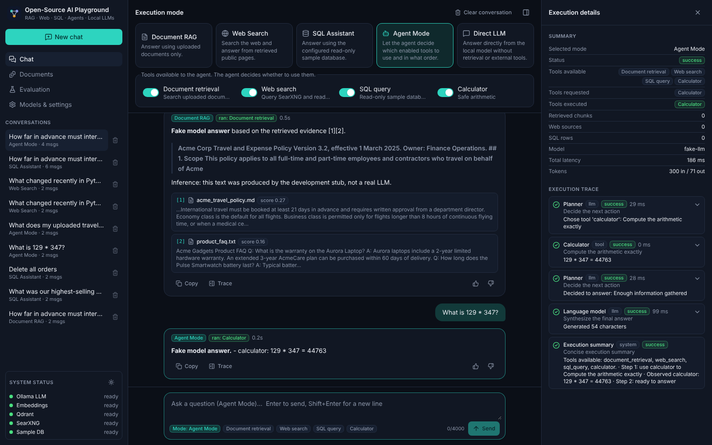

### Quick start (no Docker)

Use **Python 3.11–3.13** (3.12 recommended) and Node.js 20+. Complete the one-time setup first, then run each service in its own terminal.

**macOS / Linux**

```bash
# 0. once: install Ollama from https://ollama.com/download, then
ollama pull qwen2.5:7b
cp .env.example .env
(cd backend && python3 -m venv .venv && .venv/bin/pip install -r requirements-dev.txt \
   && .venv/bin/python -m app.cli init && .venv/bin/python -m app.cli download-embedding-model)
(cd frontend && npm install)
scripts/setup-searxng.sh            # optional, only needed for Web Search

# 1. ollama serve                   (skip if the Ollama app is already running)
# 2. scripts/run-searxng.sh         (optional; needed only for Web Search)
# 3. cd backend && .venv/bin/uvicorn app.main:app --port 8000
# 4. cd frontend && npm run dev     then open http://localhost:5173
```

**Windows (PowerShell)**

```powershell
# One-time setup, run from the repository root in PowerShell.
# Install Python 3.12 (enable "Add python.exe to PATH"), Node.js 20+ and Ollama first.
ollama pull qwen2.5:7b
if (-not (Test-Path .env)) { Copy-Item .env.example .env }
py -3.12 -m venv backend\.venv
backend\.venv\Scripts\python -m pip install --upgrade pip
backend\.venv\Scripts\python -m pip install -r backend\requirements-dev.txt
Push-Location backend
.venv\Scripts\python -m app.cli init
.venv\Scripts\python -m app.cli download-embedding-model
Pop-Location
Push-Location frontend
npm install
Pop-Location

```

Start each service in its own PowerShell terminal, from the repository root. Ollama usually starts with Windows, so skip Terminal 1 if it is already running.

**Terminal 1 (Ollama, only if needed)**

```powershell
ollama serve
```

**Terminal 2 (backend)**

```powershell
Push-Location backend
.venv\Scripts\uvicorn app.main:app --host 127.0.0.1 --port 8000
```

**Terminal 3 (frontend)**

```powershell
Push-Location frontend
npm run dev -- --host 127.0.0.1
```

Open <http://127.0.0.1:5173>.

On Windows, Web Search additionally requires SearXNG running in WSL2 (section 9) or another reachable SearXNG instance. Direct LLM, Document RAG and SQL work without it; Agent Mode works too, but cannot use its web-search tool while SearXNG is unavailable. The default chat model is several gigabytes, and CPU-only generation can be slow.

**Verify the setup and try a first RAG question**

1. Open <http://127.0.0.1:8000/api/v1/health>. Ollama, embeddings, vector store and sample database should report `ok`. `web_search` may report `false` if SearXNG is not set up.
2. In the app, open **Documents** and upload `backend/app/evaluation/fixtures/product_faq.txt`.
3. Return to **Chat**, select **Document RAG**, and ask: “How many adjustable noise cancellation levels do Echo Wireless Earbuds have?” The answer should be grounded in the uploaded FAQ.
4. Select **Direct LLM** to try a general question without document retrieval. Select **Web Search** only after SearXNG is healthy.

Web Search uses SearXNG's enabled search engines; this project does not call the Google Search API directly. See [SearXNG configuration](#9-searxng-configuration) before demoing web results.

Docker Compose is supported too ([section 13](#13-docker-compose-usage)) but is optional.

---

## Contents

1. [Project overview](#1-project-overview)
2. [Architecture diagram](#2-architecture-diagram)
3. [Technology stack and licenses](#3-technology-stack-and-licenses)
4. [Prerequisites](#4-prerequisites)
5. [Local installation](#5-local-installation)
6. [Ollama installation and model setup](#6-ollama-installation-and-model-setup)
7. [Embedding model setup](#7-embedding-model-setup)
8. [Qdrant local setup](#8-qdrant-local-setup)
9. [SearXNG configuration](#9-searxng-configuration)
10. [Environment variables](#10-environment-variables)
11. [Running the backend](#11-running-the-backend)
12. [Running the frontend](#12-running-the-frontend)
13. [Docker Compose usage (optional)](#13-docker-compose-usage)
14. [Running tests](#14-running-tests)
15. [API documentation](#15-api-documentation)
16. [Example questions](#16-example-questions)
17. [Troubleshooting](#17-troubleshooting)
18. [Known limitations](#18-known-limitations)
19. [Security considerations](#19-security-considerations)
20. [Future improvements](#20-future-improvements)

Further reading: [docs/ARCHITECTURE.md](docs/ARCHITECTURE.md) (design notes) and [docs/sample-evaluation-report.md](docs/sample-evaluation-report.md).

---

## 1. Project overview

| Mode | What runs | What never runs |
| --- | --- | --- |
| **Document RAG** | Embed the query, retrieve from Qdrant (top-k and threshold, optional local reranker), answer only from the retrieved chunks, then validate citations | Web, SQL, agent |
| **Web Search** | Query SearXNG, fetch permitted public pages through an SSRF-guarded fetcher, answer from snippets and page text, then validate citations | Documents, SQL, agent |
| **SQL Assistant** | The LLM writes SQL, an independent validator (sqlglot) checks it, it executes on a read-only SQLite connection with an authorizer, timeout and row limit, and the result is explained | Documents, web, agent |
| **Agent Mode** | A LangGraph state machine picks among the **enabled** tools (document retrieval, web search, SQL, calculator) and may use zero, one or several, within iteration, tool-call and time limits | Disabled tools (rejected by an allowlist and never executed) |
| **Direct LLM** | The local model with recent conversation history only | All tools |

Every response uses one schema (`ChatResponse`):
- `mode`, `available_tools`, `selected_tools` and `executed_tools`
- `steps`, with tool, status, summary, input/result summary, latency and error
- `sources` and `citations`
- `counts` (chunks, web sources, SQL rows)
- `model` and `embedding_model`
- `latency_ms`, `token_usage` (estimated when Ollama does not report it), `errors` and `warnings`

The UI displays all of these, and the same data is streamed as typed SSE events.

### RAG vs ordinary tool calling vs agentic orchestration

- **RAG (retrieval-augmented generation)** is a fixed pipeline: *retrieve, then generate*. Retrieval always happens and the model never decides whether to run it. Quality depends on chunking, embeddings and the prompt's grounding rules. Document RAG mode is this pipeline.
- **Ordinary tool calling** is a single decision. The model is shown tool schemas and emits one structured call, the application executes it, and the model answers from the result. Web Search and SQL Assistant modes are fixed one-tool pipelines in this spirit, where the application rather than the model chooses the tool. Inside Agent Mode, each `decide` step is a single tool call constrained by a JSON schema.
- **Agentic orchestration** puts that decision in a **loop with state**: analyze, decide, validate, execute, observe, and decide again (another tool or stop), then synthesize. It handles multi-step questions such as "which product earned the most revenue, and what is 15% of that?" (SQL, then calculator). In exchange it needs safeguards: allowlists, argument validation, iteration and tool-call limits, timeouts, cancellation and duplicate-call detection. Agent Mode implements this with LangGraph.

The evaluation page runs one question through several modes side by side so you can see these trade-offs in practice.

## 2. Architecture diagram

### Overall system

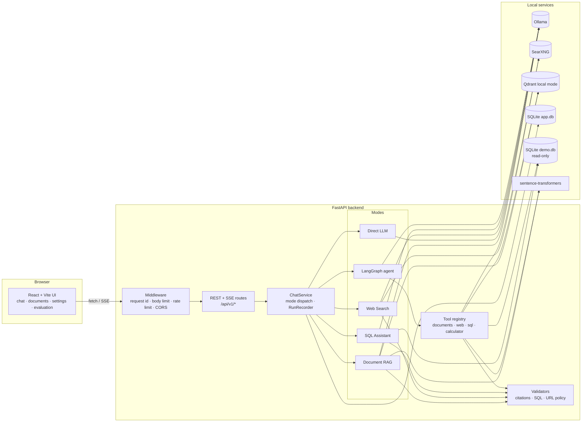

### Document ingestion

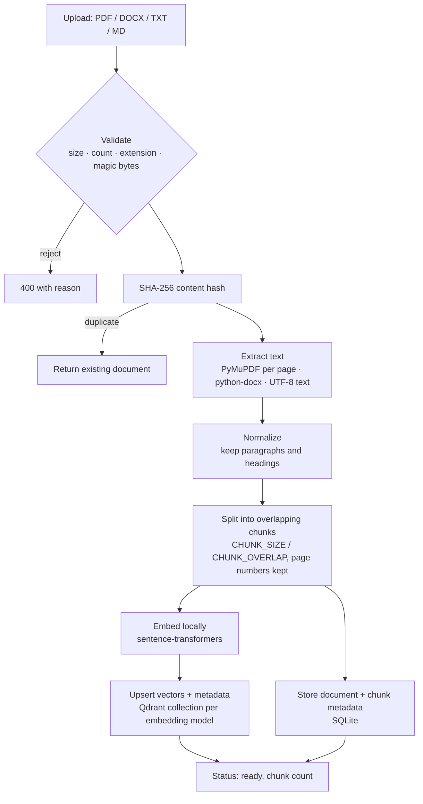

### RAG query flow

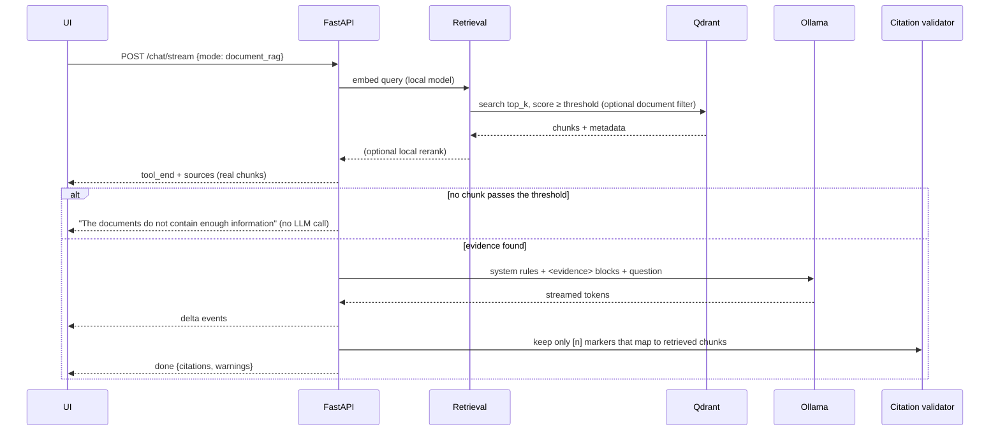

### Agent execution graph

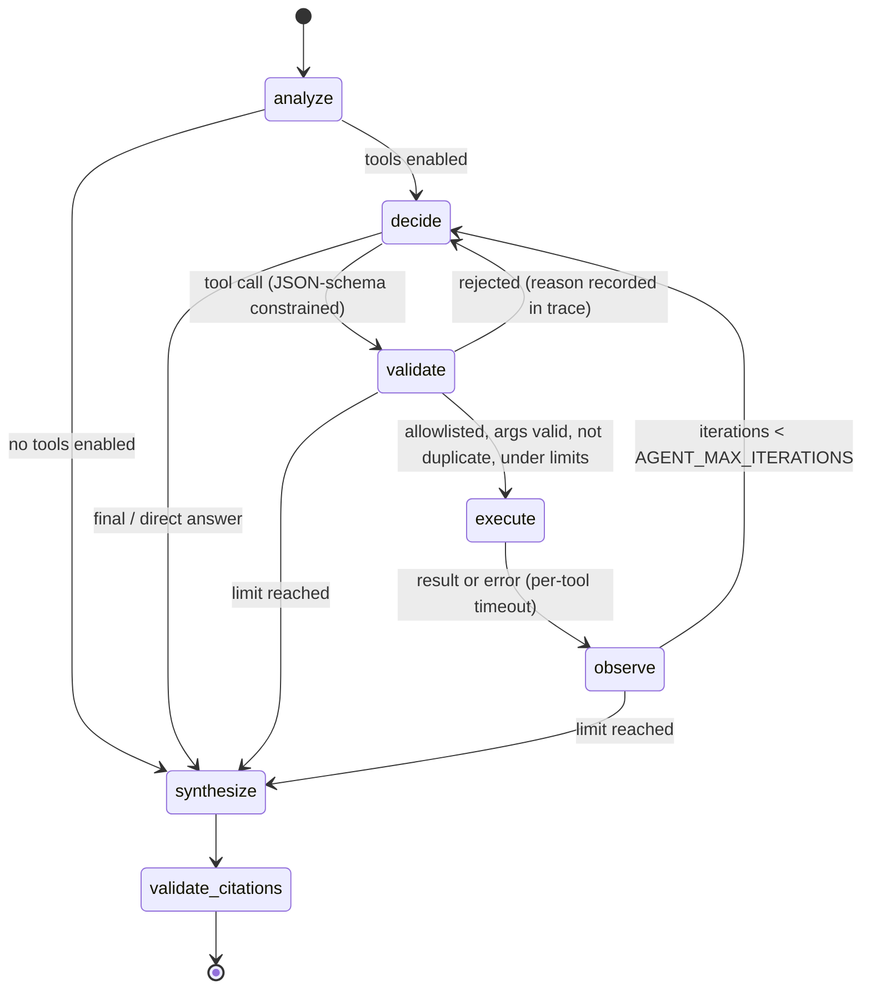

The `decide` node sends Ollama a `format` JSON schema whose `tool` enum contains **only the enabled tools**. The `validate` node re-checks the allowlist anyway, so a disabled tool can never execute even if the model names it. The whole run is wrapped in `AGENT_REQUEST_TIMEOUT_S` and is cancelled when the client disconnects or presses Stop.

## 3. Technology stack and licenses

Check licenses yourself before redistributing. This table reflects my best understanding at the time of writing and is not legal advice.

### Software

| Component | Role | License |
| --- | --- | --- |
| React, Vite, Vitest | UI, build, tests | MIT |
| TypeScript | Language | Apache-2.0 |
| Tailwind CSS | Styling | MIT |
| react-markdown, rehype-highlight, highlight.js | Markdown and code highlighting | MIT / BSD-3-Clause |
| lucide-react | Icons | ISC |
| React Testing Library | Frontend tests | MIT |
| FastAPI, Pydantic, pydantic-settings, Uvicorn | API | MIT / BSD-3-Clause |
| SQLAlchemy | Persistence | MIT |
| httpx, httpcore | HTTP client and SSRF-guarded transport | BSD-3-Clause |
| LangGraph | Agent state machine | MIT |
| sqlglot | SQL parsing and validation | MIT |
| qdrant-client (local mode) / Qdrant server | Vector store | Apache-2.0 |
| sentence-transformers | Local embeddings | Apache-2.0 |
| PyTorch | Embedding runtime | BSD-3-Clause |
| **PyMuPDF** | PDF extraction | **AGPL-3.0** (or a commercial license from Artifex). If AGPL does not suit you, `pypdf` (BSD-3-Clause) is a drop-in alternative for plain text extraction in `app/services/text_processing.py`. |
| python-docx | DOCX extraction | MIT |
| BeautifulSoup4 | HTML parsing | MIT |
| Ollama | Local LLM runtime | MIT |
| **SearXNG** | Self-hosted metasearch | **AGPL-3.0** (runs as a separate service; this app only calls its HTTP API) |
| pytest, pytest-asyncio, ruff | Backend tests and linting | MIT |

### Models

Ollama serves many models, and **their licenses differ**. The model's page on ollama.com links to its license.

| Model | Suggested use | License |
| --- | --- | --- |
| `qwen2.5:7b` (default) | Chat, JSON tool selection | Apache-2.0 |
| `qwen2.5:3b` | Smaller machines | **Qwen Research License** (non-commercial). Not Apache. |
| `mistral:7b` | Chat | Apache-2.0 |
| `llama3.2:3b` / `llama3.1:8b` | Chat | Llama Community License (use restrictions and attribution) |
| `phi3.5` | Small machines | MIT |
| `gemma2` | Chat | Gemma Terms of Use |
| `sentence-transformers/all-MiniLM-L6-v2` (default embeddings) | 384-dim embeddings | Apache-2.0 |
| `cross-encoder/ms-marco-MiniLM-L-6-v2` (optional reranker) | Reranking | Apache-2.0 |

## 4. Prerequisites

- **Python 3.11+** (developed and tested on 3.13) and **Node.js 20+** (tested on Node 22, npm 10).
- **Ollama**, installed natively ([section 6](#6-ollama-installation-and-model-setup)).
- **git**, for installing SearXNG from source. SearXNG itself runs on Linux and macOS; on Windows run it inside WSL2, or skip it (every mode except Web Search and the agent's web tool works without it).
- Docker is **not** required. It is only an optional alternative ([section 13](#13-docker-compose-usage)).
- About 6 GB of RAM free for a 7B model at Q4. Use a 3B model on smaller machines. A GPU is optional.
- About 1 GB of disk for the CPU build of PyTorch plus the embedding model.

## 5. Local installation

Everything installs natively. No Docker is needed. You need **Python 3.11, 3.12 or 3.13** (3.12 is the safest choice on Windows, where every dependency ships prebuilt wheels).

### macOS / Linux

```bash
git clone https://github.com/AbhishekRay109/ai_playground.git && cd ai_playground
cp .env.example .env

# Backend (Python virtual environment)
cd backend
python3 -m venv .venv
source .venv/bin/activate
pip install --index-url https://download.pytorch.org/whl/cpu torch   # optional: CPU-only torch, much smaller
pip install -r requirements-dev.txt                     # or requirements.txt without the test tools
python -m app.cli init                                  # creates data/app.db, data/demo.db, data/qdrant
python -m app.cli download-embedding-model              # one-time ~90 MB download (section 7)
cd ..

# Frontend
cd frontend && npm install && cd ..

# SearXNG for Web Search (Linux/macOS/WSL2), installed into .local/searxng
scripts/setup-searxng.sh
```

### Windows (PowerShell)

1. Install **Python 3.12** from <https://www.python.org/downloads/windows/> and tick **"Add python.exe to PATH"**. Avoid the Microsoft Store version and old Anaconda environments: they cause the SSL and "could not find a version" errors in [Troubleshooting](#17-troubleshooting).
2. Install **Node.js LTS** from <https://nodejs.org> and **Git** from <https://git-scm.com/download/win>.
3. Then:

```powershell
git clone https://github.com/AbhishekRay109/ai_playground.git
cd ai_playground
copy .env.example .env

# Backend
cd backend
py -3.12 -m venv .venv
.venv\Scripts\Activate.ps1          # if blocked: Set-ExecutionPolicy -Scope CurrentUser RemoteSigned
python -m pip install --upgrade pip
pip install --index-url https://download.pytorch.org/whl/cpu torch   # optional: CPU-only torch, much smaller
pip install -r requirements-dev.txt
python -m app.cli init
python -m app.cli download-embedding-model
cd ..

# Frontend
cd frontend
npm install
cd ..
```

In Command Prompt (cmd.exe) instead of PowerShell, activate with `.venv\Scripts\activate.bat`. SearXNG (Web Search only) does not run natively on Windows; see [section 9](#9-searxng-configuration) for the WSL2 route.

### Notes

On a Mac with Apple Silicon or a machine with an NVIDIA GPU, skip the CPU-only torch line so pip installs the accelerated build.

Python dependencies are listed in `backend/requirements.txt` (runtime, as version ranges so pip picks builds that exist for your Python and OS) and `backend/requirements-dev.txt` (adds pytest and ruff). `pyproject.toml` declares the same packages, so `pip install -e ".[embeddings,dev]"` also works. If you comment out `sentence-transformers` in `requirements.txt`, PyTorch is not installed. In that case set `EMBEDDING_PROVIDER=hash` to use the deterministic lexical embedder (offline and lower quality, mostly useful for tests and UI work).

## 6. Ollama installation and model setup

1. Install Ollama natively:
   - **macOS / Windows**: download the installer from <https://ollama.com/download> and run it. Ollama then runs in the background (menu bar / system tray).
   - **Linux**: `curl -fsSL https://ollama.com/install.sh | sh` (installs a systemd service), or start it by hand with `ollama serve`.
2. Pull a model. This is the only step that downloads LLM weights, and the app never does it for you.
   ```bash
   ollama pull qwen2.5:7b        # ~4.7 GB, Apache-2.0
   # smaller: ollama pull phi3.5  (MIT)   or   ollama pull llama3.2:3b (Llama Community License)
   ```
3. Check it is running: `curl http://localhost:11434/api/tags`.
4. In the app, open **Settings** to see installed models (name, size, quantization, family). Click one to make it the chat model. The choice is stored in SQLite and overrides `OLLAMA_MODEL`. If the configured model is not installed, the status panel and every chat error say so and give the `ollama pull` command.

Tool selection uses Ollama's structured outputs (`format` with a JSON schema). Models smaller than about 3B follow the schema less reliably. When that happens the planner step is marked as an error ("Planner returned output that is not valid JSON"), it retries once and then stops with a limit message instead of guessing.

## 7. Embedding model setup

By default weights are loaded with `local_files_only=True`, so **nothing is downloaded at runtime**. Download once, explicitly:

```bash
cd backend
python -m app.cli download-embedding-model                       # EMBEDDING_MODEL (+ RERANKER_MODEL if set)
python -m app.cli download-embedding-model --model BAAI/bge-small-en-v1.5
```

Alternatively, set `EMBEDDING_ALLOW_DOWNLOAD=true` to let the first request download the model.

Each embedding model gets its own Qdrant collection, because vector dimensions differ between models. If you change `EMBEDDING_MODEL` (in `.env` or the Settings page), existing documents are marked **stale**. Click **Re-index** on the Documents page (or call `POST /api/v1/documents/{id}/reindex`) to re-embed them from the chunk text stored in SQLite.

**Chunking defaults.** `CHUNK_SIZE=1000` characters with `CHUNK_OVERLAP=150`. That is about 200–250 tokens per chunk, comfortably inside MiniLM's 256-token window, and large enough to keep a paragraph's context. The 15% overlap keeps sentences that span a boundary retrievable from either side. Chunks break on paragraph, then sentence, then word boundaries, and never span PDF pages, so page citations stay exact. `RAG_TOP_K=5` and `RAG_SCORE_THRESHOLD=0.3` (cosine) are conservative for MiniLM. Lower the threshold if relevant chunks are dropped, and raise it if irrelevant ones get through.

## 8. Qdrant local setup

There is nothing to install. With `QDRANT_URL` empty, the backend uses **Qdrant local mode** (embedded, on-disk) at `data/qdrant`. Local mode allows only one process at a time, so run a single backend worker.

To use a Qdrant server instead, run the native Qdrant binary from <https://github.com/qdrant/qdrant/releases> (or the optional Compose profile `qdrant-server`) and set `QDRANT_URL=http://localhost:6333`.

## 9. SearXNG configuration

SearXNG runs natively from source, following its documented developer install:

```bash
scripts/setup-searxng.sh     # clones SearXNG into .local/searxng and installs it in its own virtualenv
scripts/run-searxng.sh       # serves it on 127.0.0.1:8080 with searxng/settings.yml
curl "http://127.0.0.1:8080/search?q=python&format=json" | head -c 300
```

`run-searxng.sh` uses `SEARXNG_SECRET` from your environment or `.env`, and generates a random one if it is still the placeholder. `searxng/settings.yml` enables the **JSON output format**, which the backend needs (`/search?format=json`) and which SearXNG turns off by default. It also disables the rate limiter for local use. SearXNG does not support native Windows. Either leave it off (the other four modes work without it) or run it in **WSL2**:

```powershell
wsl --install -d Ubuntu          # once, then restart and open the "Ubuntu" app
```

```bash
# inside Ubuntu (WSL2); C:\path\to\ai_playground is /mnt/c/path/to/ai_playground
sudo apt update && sudo apt install -y python3-venv python3-dev git build-essential
cd /mnt/c/path/to/ai_playground
bash scripts/setup-searxng.sh
bash scripts/run-searxng.sh      # reachable from Windows at http://localhost:8080
```

The backend keeps running on Windows with the default `SEARXNG_URL=http://localhost:8080`, because WSL2 forwards `localhost` to Windows.

Point the backend at another instance with `SEARXNG_URL`. Public instances usually disable JSON or rate-limit heavily, so a local instance is recommended. If SearXNG is down, Web Search mode and the agent's web tool return a clear 503 error and a hint. There is **no fallback provider**.

The page fetcher follows `robots.txt` (`WEB_RESPECT_ROBOTS`). It does not retry or work around 401/403/429 responses, paywalls or CAPTCHAs. Pages it cannot fetch are labelled "snippet only" and the answer uses the search snippet instead.

## 10. Environment variables

All are optional and the defaults are shown. See [`.env.example`](.env.example), which contains placeholders only. The backend reads `../.env` and then `backend/.env`, and real environment variables win.

| Variable | Default | Purpose |
| --- | --- | --- |
| `OLLAMA_BASE_URL` | `http://localhost:11434` | Ollama endpoint |
| `OLLAMA_MODEL` | `qwen2.5:7b` | Default chat model (Settings can override) |
| `LLM_TEMPERATURE` / `LLM_MAX_TOKENS` / `LLM_TIMEOUT_S` | `0.2` / `1024` / `120` | Generation options |
| `LLM_HISTORY_MESSAGES` | `10` | Prior messages sent to the model |
| `EMBEDDING_PROVIDER` | `sentence-transformers` | `sentence-transformers` or `hash` (offline, lexical) |
| `EMBEDDING_MODEL` | `sentence-transformers/all-MiniLM-L6-v2` | Local embedding model |
| `EMBEDDING_DEVICE` | `cpu` | `cpu`, `cuda` or `mps` |
| `EMBEDDING_ALLOW_DOWNLOAD` | `false` | Allow runtime download of embedding weights |
| `RERANKER_MODEL` | *(empty)* | Optional local cross-encoder |
| `QDRANT_URL` | *(empty = local mode)* | Qdrant server URL |
| `MAX_UPLOAD_MB` / `MAX_FILES_PER_UPLOAD` / `MAX_DOCUMENTS` / `MAX_PDF_PAGES` | `20` / `5` / `200` / `500` | Upload limits |
| `CHUNK_SIZE` / `CHUNK_OVERLAP` | `1000` / `150` | Chunking (characters) |
| `RAG_TOP_K` / `RAG_SCORE_THRESHOLD` | `5` / `0.3` | Retrieval |
| `SEARXNG_URL` | `http://localhost:8080` | Search endpoint |
| `SEARXNG_SECRET` | placeholder | Secret for SearXNG, read by `scripts/run-searxng.sh` and Docker Compose |
| `SEARCH_RESULTS` / `WEB_FETCH_PAGES` / `WEB_FETCH_TIMEOUT_S` | `5` / `3` / `8` | Web limits |
| `WEB_RESPECT_ROBOTS` | `true` | Honour robots.txt |
| `WEB_ALLOWED_DOMAINS` / `WEB_BLOCKED_DOMAINS` | *(empty)* | Comma-separated domain lists (allowlist empty = any public domain) |
| `SQL_ROW_LIMIT` / `SQL_TIMEOUT_S` | `200` / `3` | SQL limits |
| `AGENT_MAX_ITERATIONS` / `AGENT_MAX_TOOL_CALLS` | `6` / `4` | Agent loop bounds |
| `AGENT_TOOL_TIMEOUT_S` / `AGENT_REQUEST_TIMEOUT_S` | `45` / `240` | Agent timeouts |
| `CORS_ORIGINS` | `http://localhost:5173,http://127.0.0.1:5173` | Allowed browser origins |
| `RATE_LIMIT_PER_MINUTE` | `60` | Per-client limit on chat, upload and eval routes |
| `MAX_REQUEST_BYTES` | `262144` | JSON body limit (uploads use `MAX_UPLOAD_MB`) |
| `LOG_LEVEL` | `INFO` | Log level |
| `LOG_CONTENT` | `false` | When false, prompts, questions and document text are redacted from logs |
| `DATA_DIR` | `./data` | Where app.db, demo.db and qdrant/ live |

## 11. Running the backend

```bash
cd backend && source .venv/bin/activate      # Windows: cd backend; .venv\Scripts\Activate.ps1
uvicorn app.main:app --host 127.0.0.1 --port 8000 --reload
```

- Health: <http://127.0.0.1:8000/api/v1/health> (reports Ollama, the model, embeddings, Qdrant, SearXNG and the databases, each with a hint).
- OpenAPI docs: <http://127.0.0.1:8000/api/v1/docs>.
- Run one worker only, because Qdrant local mode is single-process.

**No Ollama yet?** `scripts/dev_stubs.py` imitates the Ollama and SearXNG HTTP APIs with **deterministic, rule-based responses. It is not a language model.** Use it only to exercise the UI, streaming, validators and agent loop:

```bash
python scripts/dev_stubs.py --port 11435 &
OLLAMA_BASE_URL=http://localhost:11435 OLLAMA_MODEL=fake-llm SEARXNG_URL=http://localhost:11435 \
  EMBEDDING_PROVIDER=hash uvicorn app.main:app --port 8000
```

On Windows PowerShell, run the stub in its own terminal (`python scripts/dev_stubs.py --port 11435`), then in another:

```powershell
$env:OLLAMA_BASE_URL="http://localhost:11435"; $env:OLLAMA_MODEL="fake-llm"
$env:SEARXNG_URL="http://localhost:11435"; $env:EMBEDDING_PROVIDER="hash"
uvicorn app.main:app --port 8000
```

## 12. Running the frontend

```bash
cd frontend
npm run dev          # http://localhost:5173 (proxies /api to http://localhost:8000)
npm run build        # production build in dist/
```

## 13. Docker Compose usage

**Optional.** Everything above runs without Docker. Use this only if you prefer containers.

```bash
cp .env.example .env && sed -i "s/change-me-to-a-random-string/$(openssl rand -hex 32)/" .env
docker compose up -d --build
docker compose exec ollama ollama pull qwen2.5:7b
docker compose exec backend python -m app.cli download-embedding-model
open http://localhost:5173
```

| Service | Port (bound to 127.0.0.1) | Notes |
| --- | --- | --- |
| frontend | 5173 | nginx serving the build; `/api` is proxied to the backend with buffering off for SSE |
| backend | 8000 | Non-root user, health check, volumes `app-data` and `hf-models` |
| ollama | 11434 | Volume `ollama`. For an NVIDIA GPU, uncomment the `deploy` block |
| searxng | 8080 | Uses `searxng/settings.yml` |
| qdrant | 6333 | Only with `--profile qdrant-server` |

To build a slimmer backend image without sentence-transformers and torch, add `build.args: {INSTALL_EMBEDDINGS: "false"}` to the backend service and set `EMBEDDING_PROVIDER=hash`. If you already run Ollama on the host, remove the `ollama` service and set `OLLAMA_BASE_URL=http://host.docker.internal:11434` (on Linux, also add `extra_hosts: ["host.docker.internal:host-gateway"]`).

## 14. Running tests

```bash
# Backend: no LLM, network or model weights needed (external services are faked)
cd backend && pytest -q                   # 149 passed, 4 skipped
ruff check . && ruff format --check .

# Optional live integration tests against a real Ollama, embeddings and SearXNG
RUN_INTEGRATION=1 pytest tests/integration -q

# Frontend
cd frontend && npm test                   # Vitest + React Testing Library (16 tests)
npm run typecheck
```

The unit tests use a scripted LLM, the deterministic hash embedder, a real Qdrant local store in a temp directory, a real SQLite demo database, mocked SearXNG and HTTP transports, and a fake DNS resolver. One SSRF test opens a real local socket to prove the guarded transport refuses `127.0.0.1`. Coverage:
- parsing and chunking; ingestion → retrieval → citations; missing evidence
- web failures (SearXNG down, timeouts, redirects to private IPs, robots.txt, oversized pages)
- SQL validation, and write/DDL/multi-statement/`ATTACH`/pragma rejection
- disabled-tool enforcement; agent iteration and tool-call limits; tool timeouts; cancellation
- model-unavailable errors; session persistence; feedback; API validation
- no stack traces in responses; evaluation metrics

The 4 skipped tests are the live integration suite.

**Reproducible evaluation:**

```bash
cd backend
python -m app.cli eval --dataset default --out ../docs/evaluation-report.md --json report.json
```

The default dataset (`app/evaluation/datasets/default.json`) ingests three fixture documents and runs 12 questions. These cover RAG (including unanswerable questions and a prompt-injection document) and agent tool selection (including disabled-tool cases). The [sample report](docs/sample-evaluation-report.md) was produced with the dev stubs and is labelled as such.

Metrics:
- **Retrieval hit rate** and **Recall@k** against known ground-truth chunks.
- **Citation validity**: the share of cited markers that map to retrieved sources.
- **Completeness (estimate)** and **Groundedness (lexical estimate)**: keyword and overlap heuristics, labelled as estimates.
- **Tool-selection success** against the expected tool set.
- **Task completion**, **correct abstention**, and latency p50/p95.

No LLM-as-judge score is presented as truth.

## 15. API documentation

Interactive OpenAPI docs are served at `/api/v1/docs`. All routes are under `/api/v1`.

| Method | Path | Purpose |
| --- | --- | --- |
| `POST` | `/chat` | Run one question and return the full `ChatResponse` |
| `POST` | `/chat/stream` | Same, streamed as SSE |
| `POST` | `/messages/{message_id}/feedback` | Rate an answer (up or down, optional comment) |
| `POST` / `GET` | `/documents` | Upload (multipart, `files`) / list |
| `DELETE` | `/documents/{id}` | Delete a document, its chunks and its vectors |
| `POST` | `/documents/{id}/reindex` | Re-embed with the current embedding model |
| `GET` / `DELETE` | `/sessions`, `/sessions/{id}` | List, read, or delete a conversation (and its messages and feedback) |
| `GET` | `/models` | Installed Ollama models |
| `GET` | `/health` | Per-service status with hints |
| `GET` / `PUT` | `/config` | Runtime settings (whitelisted fields only) and read-only limits |
| `POST` | `/config/reset` | Restore environment defaults |
| `POST` | `/evaluation/compare` | Run one question through several modes |
| `GET` / `POST` | `/evaluation/datasets`, `/evaluation/run` | List and run benchmark datasets |

**Chat request**

```json
{
  "session_id": null,
  "question": "Which product earned the most revenue, and what is 15% of that amount?",
  "mode": "agent",
  "enabled_tools": ["sql_query", "calculator"],
  "settings": {"temperature": 0.2, "top_k": 5, "score_threshold": 0.3, "document_ids": null}
}
```

**SSE events** (`event:` name, JSON `data:`):

| Event | Meaning |
| --- | --- |
| `session` | Session and message IDs |
| `status` | Phase change |
| `tool_start` | A tool began, with an input summary |
| `tool_end` | A tool finished, with real status, result summary and latency |
| `sources` | Evidence registered for citation |
| `delta` | Answer text |
| `done` | Final `ChatResponse` |
| `error` | Code, message, hint and `retryable` |

`tool_end` is only sent after the tool has actually returned.

Errors always use the shape `{"error": {"code", "message", "hint", "retryable", "request_id"}}`, never a stack trace.

## 16. Example questions

The UI shows these per mode. After uploading `backend/app/evaluation/fixtures/*`:

- **Document RAG**: "How far in advance must international travel be booked?", "What does the travel policy say about exclusions?", "Summarize the key requirements in the security handbook."
- **Web Search**: "What is the latest stable release of PostgreSQL?", "What changed recently in the Python ecosystem?"
- **SQL Assistant**: "What was our highest-selling product by units?", "What was total revenue per year?", "Which country has the most customers?" Tables: `products`, `customers`, `orders`, `monthly_sales`, with deterministic seed data.
- **Agent Mode**: "Which product earned the most revenue, and what is 15% of that amount?" (SQL then calculator), "Compare the uploaded policy with recent public guidance." (documents and web), "What is 129 * 347?" (calculator). Disable SQL and ask about top sellers to see the agent explain the limitation instead of using another tool.
- **Direct LLM**: "Explain the difference between RAG and fine-tuning."

### Screenshots

These were captured from the running app. The answers come from the dev stubs, not a real model.

| | |
| --- | --- |
| 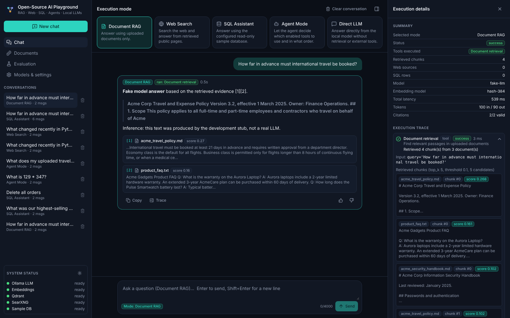 Document RAG with citations |  Agent trace: available vs executed |
| 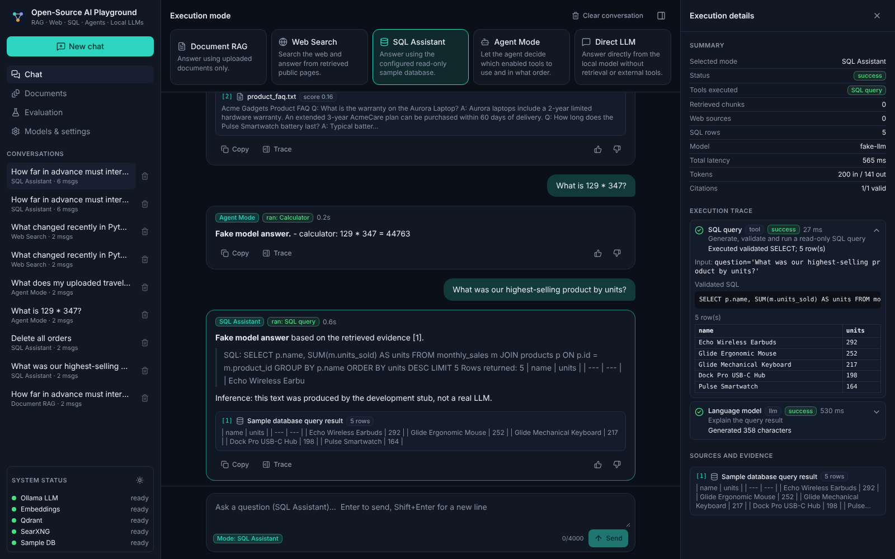 Validated SQL and result rows | 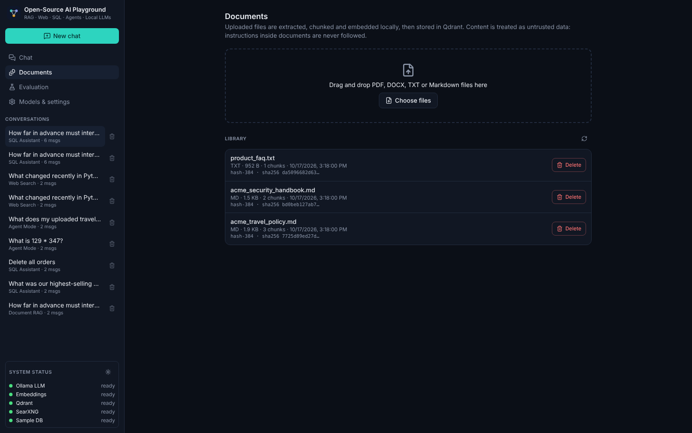 Document management |
| 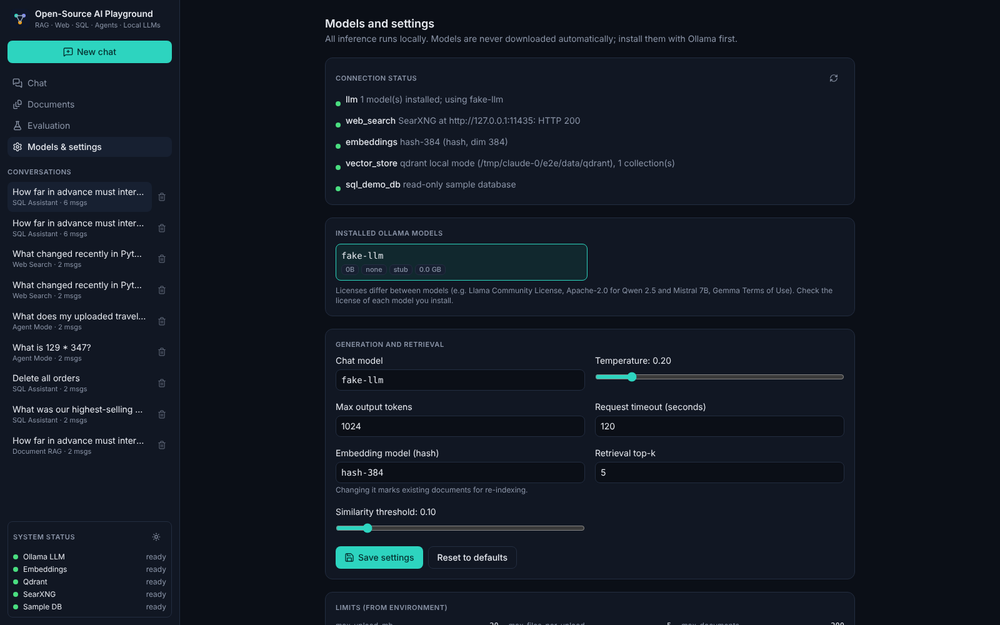 Models and service status | 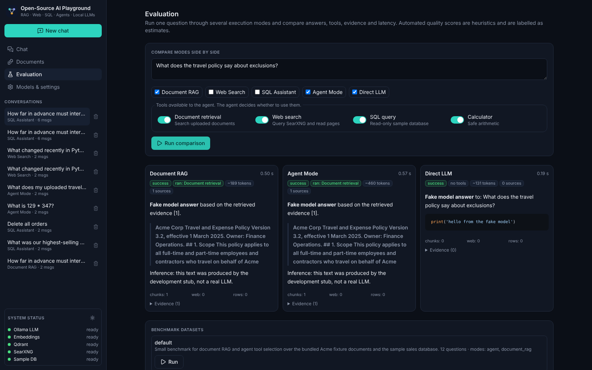 Side-by-side comparison |
| 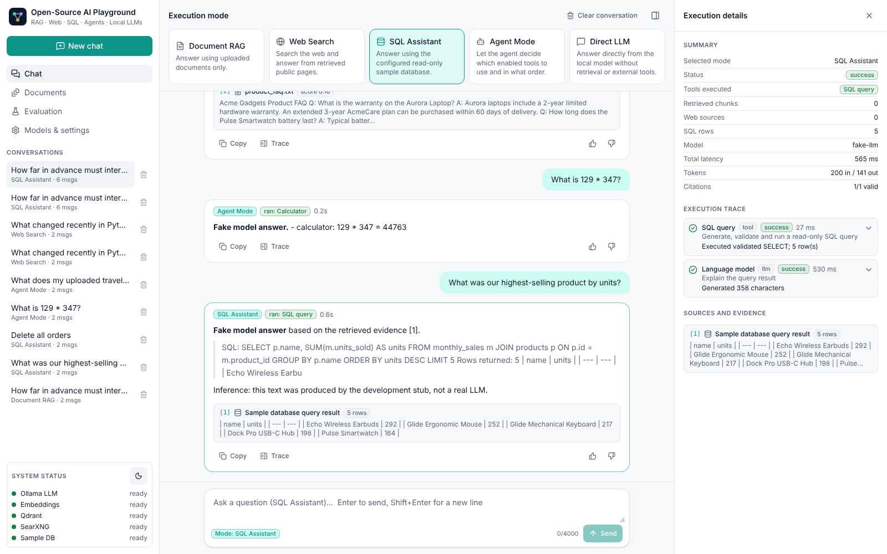 Light theme | 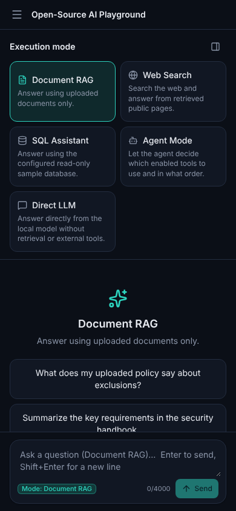 Mobile layout |

To recapture with a real model, run the stack, upload the fixtures, ask the example questions above, and screenshot at 1440×900 (and 390×844 for mobile).

## 17. Troubleshooting

| Symptom | Fix |
| --- | --- |
| pip: `Could not find a version that satisfies the requirement …` | Usually your Python is too old or pip cannot reach PyPI. Check `python --version` (needs 3.11–3.13) and run `python -m pip install --upgrade pip`. If the message ends with `(from versions: none)`, pip could not download anything at all: see the SSL row below. |
| pip: `Building wheel for greenlet … error`, or `Microsoft Visual C++ 14.0 or greater is required` | pip is compiling a package from source because no prebuilt wheel matches your Python. Check `python --version` inside the venv (it must be 3.11–3.13; 3.12 is safest on Windows) and that it is 64-bit (`python -c "import struct; print(struct.calcsize('P')*8)"` prints 64). Then upgrade pip (`python -m pip install --upgrade pip`), delete the venv and recreate it with `py -3.12 -m venv .venv`. The app itself no longer depends on greenlet. |
| pip: `the ssl module in Python is not available` | That Python was built without SSL. On Windows, install Python from python.org (or run inside the "Anaconda Prompt" if you use Anaconda). On macOS/Linux, reinstall Python with OpenSSL (`brew install openssl@3` then reinstall via pyenv, or `sudo apt install libssl-dev` before building). Then delete `backend/.venv` and recreate it. |
| PowerShell: `Activate.ps1 cannot be loaded because running scripts is disabled` | Run `Set-ExecutionPolicy -Scope CurrentUser RemoteSigned` once, or call `.venv\Scripts\python` directly. |
| "Ollama is not reachable" | Start it (open the Ollama app, or run `ollama serve`) and check `OLLAMA_BASE_URL` (default `http://localhost:11434`). |
| "Model 'x' is not installed" | Run `ollama pull x`, or pick an installed model in Settings. |
| Answers time out | Raise `LLM_TIMEOUT_S` / `AGENT_REQUEST_TIMEOUT_S`, use a smaller model, or enable a GPU. The first request also loads the model into memory. |
| "Embedding model is not available locally" | Run `python -m app.cli download-embedding-model`, set `EMBEDDING_ALLOW_DOWNLOAD=true`, or use `EMBEDDING_PROVIDER=hash`. |
| Documents marked **stale** | The embedding model changed. Click Re-index. |
| "Storage folder … is already accessed by another instance" | Qdrant local mode is single-process. Stop the other backend, or use a Qdrant server. |
| Web Search: "SearXNG is not reachable" or 403 | Run `scripts/run-searxng.sh` (after `scripts/setup-searxng.sh`). Make sure `format: json` is enabled (it is in `searxng/settings.yml`). |
| Web Search returns no results | SearXNG is up but its engines can't reach the internet, or they are rate-limiting you. Check the SearXNG terminal for engine errors. |
| Web answers say "snippet only" | The page refused (robots.txt, 403, 429, non-HTML, too large) or timed out. This is by design. |
| SQL "rejected by validator" | Expected for writes, unknown tables or functions. The trace shows the reason and the SQL. One automatic repair attempt is made. |
| Agent trace shows "Planner returned output that is not valid JSON" | The model did not follow the JSON schema. Use a 7B+ instruction model. |
| 429 Too Many Requests | Raise `RATE_LIMIT_PER_MINUTE`. |
| Browser CORS errors | Add your origin to `CORS_ORIGINS`. |

## 18. Known limitations

- **Verification status.** The full pipeline was tested with unit tests and end-to-end over HTTP against the dev stubs, in both local processes and Docker containers (slim backend image plus frontend/nginx with SSE). These were **not** run in the build environment:
  - a real Ollama model
  - real sentence-transformers weights
  - SearXNG search results from the internet. `scripts/setup-searxng.sh` and `run-searxng.sh` were run natively and the backend reported SearXNG healthy and handled its (empty) JSON responses, but the build environment had no outbound access for SearXNG's engines.
  - the full-size backend image with torch
  - a complete `docker compose up`
  - a Windows machine. The Windows steps follow each tool's documented Windows install, and the backend avoids POSIX-only paths and relies on UTF-8 file I/O, but nothing here was run on Windows itself.

  The integration suite (`RUN_INTEGRATION=1`) exists for exactly that. Answer quality depends on the model you choose.
- Single user, single process. There is no authentication or per-user data separation.
- Token counts are estimated (characters ÷ 4) whenever Ollama does not return `prompt_eval_count`/`eval_count`.
- PDF extraction is text-layer only. There is no OCR for scanned PDFs, and tables lose their layout.
- Groundedness and completeness metrics are lexical heuristics, not semantic judgements.
- Web page extraction is a readability-style heuristic and can miss content on JavaScript-rendered sites (no headless browser).
- Retrieval is dense-only, with no hybrid BM25.
- The SQL assistant targets the bundled demo database only. Using another schema requires configuring the allowlists in `app/services/sql_safety.py`.
- Stopping a generation cancels the backend run. Ollama may keep generating briefly until it notices the closed connection.

## 19. Security considerations

**This is a local development tool for a trusted machine, not a hardened or multi-tenant service.** All ports bind to `127.0.0.1` in Compose. Controls that *are* implemented:

- **Uploads**: extension and magic-byte checks, size, file-count, document-count and PDF page limits. Content is treated as untrusted and never executed.
- **Prompt injection**: retrieved text is wrapped in `<evidence>` blocks with delimiter sanitizing, and system prompts tell the model to ignore instructions inside evidence. The fixtures include an injection attempt. This *mitigates* injection but cannot eliminate it, which is why tools are also gated by code, not by the prompt.
- **Tools**: an allowlist enforced in code, Pydantic argument validation, duplicate-call detection, iteration and tool-call caps, per-tool and overall timeouts, cancellation and bounded output sizes. The calculator is an AST evaluator with no names, attributes or calls. There is no tool for arbitrary code or shell.
- **SQL**: sqlglot validates independently of the LLM (single read statement, allowlisted tables and functions, no `ATTACH` or pragmas). Execution uses a `mode=ro` connection, `PRAGMA query_only`, a SQLite authorizer, a progress-handler timeout and a row limit.
- **SSRF**: http/https only, no credentials in URLs, hostname and domain lists, every resolved IP must be globally routable, and the connection is pinned to the validated IP (prevents DNS rebinding). Each redirect is re-validated. Timeouts, byte and content-type limits apply, and robots.txt is respected.
- **HTTP**: request-size limit, per-client rate limit, CORS from the environment, request IDs, and safe error bodies with no stack traces.
- **Secrets and logs**: `.env` is git-ignored and `.env.example` has placeholders only. Prompts, questions and document text are redacted from logs unless `LOG_CONTENT=true`. `/config` exposes only whitelisted fields.

Before exposing it beyond localhost you would need, at minimum: authentication, per-user data isolation, TLS, a shared rate limiter, a Qdrant server, and an egress proxy for the web fetcher.

## 20. Future improvements

- Hybrid retrieval (BM25 + dense) and a query-rewriting step.
- OCR for scanned PDFs and table-aware extraction.
- Authentication and per-user workspaces.
- LLM-as-judge evaluation as an *optional* second opinion, clearly labelled.
- Headless-browser fetching for JavaScript-heavy pages, behind the same SSRF policy.
- Pluggable SQL sources with per-connection allowlists.
- OpenTelemetry traces for each execution step.
- Parallel tool execution in the agent when calls are independent.
