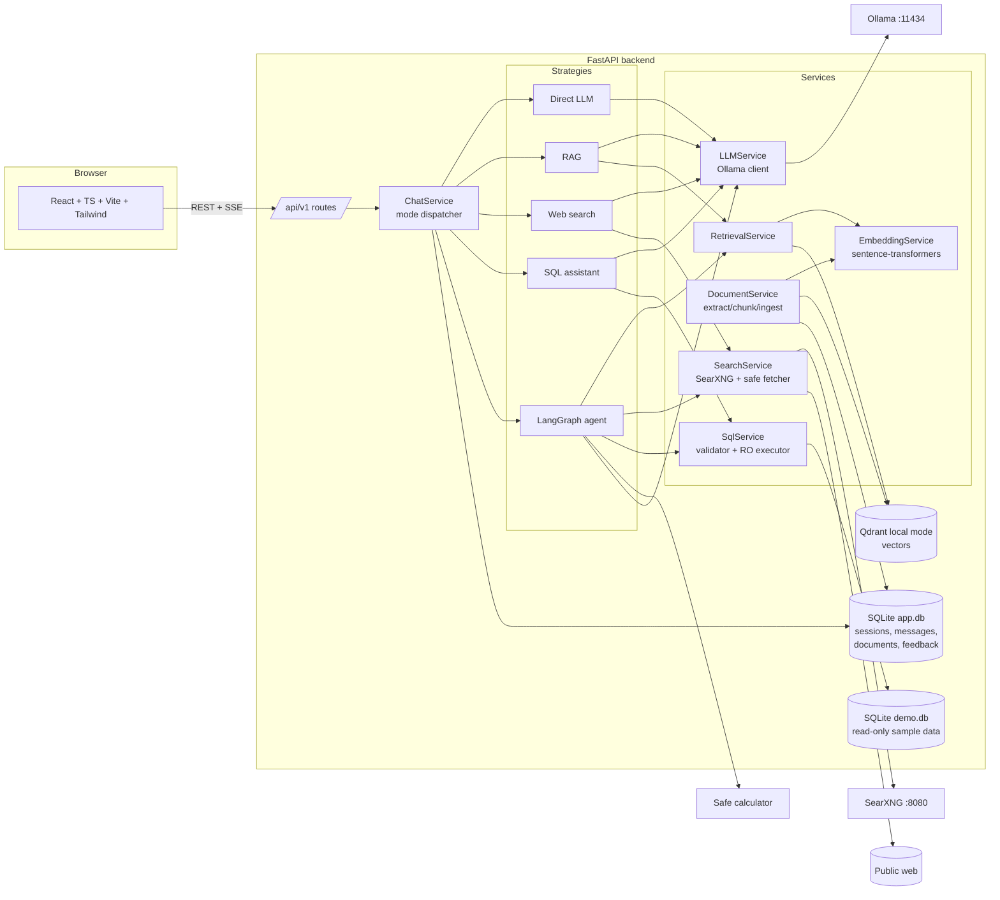

# Open-Source AI Playground: Architecture and Implementation Plan

## 1. Goals

One question, five execution strategies (Document RAG, Web Search, SQL Assistant,
Agent Mode, Direct LLM), and a UI that shows *how* each answer was produced:
which tools ran, what evidence was retrieved, which citations back the answer,
and how long each step took. Everything runs locally on open-source components.

## 2. System overview

Layering (enforced by package boundaries):

| Layer | Package | Responsibility |
|---|---|---|
| HTTP | `app/api/routes` | Request parsing, response models, SSE framing. No business logic. |
| Orchestration | `app/services/chat_service.py`, `app/agents` | Mode dispatch, event stream, LangGraph graph. |
| Tools | `app/tools` | Typed, allowlisted tool interfaces (args schema, timeout, bounded output). |
| Domain services | `app/services` | LLM, embeddings, ingestion, retrieval, search, SQL. |
| Persistence | `app/repositories`, `app/models` | SQLAlchemy models and repositories. |
| Config | `app/core` | `pydantic-settings` config, logging (no prompt/document content by default). |

## 3. Key design decisions

* **One event protocol for all modes.** Every strategy is an async generator of typed
  events: `status`, `tool_start`, `tool_end`, `sources`, `delta`, `done`, `error`.
  `POST /api/v1/chat` aggregates them into one JSON response; `POST /api/v1/chat/stream`
  sends them as Server-Sent Events. `tool_end` is only emitted after the tool really
  returned, so the UI cannot show a success before it happened.
* **Consistent response schema** (`ChatResponse`): `answer`, `mode`, `available_tools`,
  `executed_tools`, `steps[]` (tool, status, input summary, result summary, latency),
  `sources[]` (kind = document | web | sql), `model`, `embedding_model`, `latency_ms`,
  `counts` (chunks, web sources, SQL rows), `errors[]`, token estimates.
* **Citations are validated, not trusted.** The LLM is asked to cite with `[n]` markers
  that index into the evidence list we built. After generation, markers that do not
  map to a real retrieved item are stripped and reported. Sources shown are only items
  actually retrieved in that execution.
* **Untrusted content isolation.** Documents and web pages are wrapped in clearly
  delimited evidence blocks; the system prompt states that evidence is data and
  instructions inside it must be ignored. Tools are never invoked from evidence text:
  the agent can only call tools through a validated JSON decision, checked against the
  user's enabled-tool allowlist.
* **SQL safety does not depend on the LLM.** `sqlglot` parses the query; only a single
  `SELECT` (incl. CTE / UNION) over allowlisted tables and allowlisted functions passes.
  Execution then uses a separate `mode=ro` SQLite connection, `PRAGMA query_only`,
  an SQLite *authorizer* (defense in depth), a progress-handler timeout, and a row cap.
* **SSRF-safe fetcher.** Only http/https, DNS resolved and every address checked
  against private/loopback/link-local/reserved ranges, redirects followed manually and
  re-checked, byte and time limits, HTML/text content types only, optional robots.txt.
* **Agent = LangGraph `StateGraph`**: `analyze → decide → validate → execute → observe
  → (decide | synthesize) → validate_citations → END`. The decision step uses Ollama
  structured output (`format` = JSON schema built from only the *enabled* tools).
  Hard limits: max iterations, max tool calls, per-tool timeout, overall timeout,
  bounded tool output. A request for a disabled tool is recorded as `rejected` and
  never executed.
* **Embedding provider is pluggable.** Default `sentence-transformers`
  (`all-MiniLM-L6-v2`, Apache-2.0). A deterministic `hash` embedder exists for tests
  and offline demos and must be selected explicitly; it is never a silent fallback.
* **Qdrant local mode** (`QdrantClient(path=...)`) by default, no server needed;
  `QDRANT_URL` switches to a Qdrant server.
* **No paid services.** If Ollama or SearXNG is down, the user gets a clear error with
  setup hints. Nothing silently falls back to another provider.

## 4. Implementation phases

| Phase | Scope | Validation |
|---|---|---|
| 1 | Repo layout, config, logging, health/config endpoints, DB bootstrap, full UI shell (sidebar, mode cards, tool toggles, chat panel, execution panel, theme) | pytest + vitest + `vite build` |
| 2 | Ollama client (list models, chat, streaming, errors), Direct LLM mode, SSE endpoint, chat UI streaming/stop/retry/copy | unit tests with mocked Ollama, e2e against a fake Ollama server |
| 3 | Upload/validate/extract (PDF, DOCX, TXT, MD), normalize, chunk, embed, Qdrant, dedupe, delete, RAG answer with validated citations | parser/chunker tests, real Qdrant local mode with hash embedder |
| 4 | SearXNG client, safe fetcher, HTML extraction, web-grounded answer | mocked SearXNG/web via `httpx.MockTransport`, SSRF tests |
| 5 | Demo DB seed, schema introspection, sqlglot validator, read-only executor, SQL answer | validator matrix incl. write/DDL/multi-statement/unapproved table rejection |
| 6 | Tools package, LangGraph agent, limits, timeouts, traces | disabled-tool enforcement, iteration limits, tool timeouts with scripted LLM |
| 7 | Sessions/messages/feedback persistence, settings panel, evaluation API + page + dataset + metrics | API tests, frontend tests |
| 8 | Docker/Compose (backend, frontend, Ollama, SearXNG), README with Mermaid diagrams, licenses, troubleshooting, sample eval report, final polish | full test run, docker compose config check |

## 5. Environment notes for this build

The build container cannot reach `ollama.com`, Hugging Face, or a SearXNG instance.
Unit tests therefore mock those boundaries (as the spec requires), and an optional
`tests/integration` suite runs only when `RUN_INTEGRATION=1` and the local services
are up. Any feature that could not be exercised against the real service here is
listed in the README under "Verification status".
